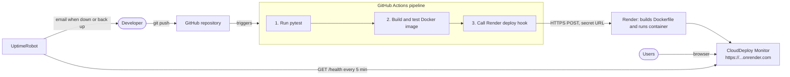

# CloudDeploy Monitor

[](https://github.com/sagniksannigrahi/clouddeploy-monitor/actions/workflows/deploy.yml)

**Automated Cloud-Native Application Deployment with Monitoring**

A small Flask web app that is automatically tested, packaged as a Docker image, deployed to the cloud (Render) by a GitHub Actions pipeline, and monitored for downtime by UptimeRobot.

---

## 1. Introduction

Every push to the `main` branch starts a pipeline: tests run, a Docker image is built and checked, and only if all of that succeeds is the new version deployed to Render. Once live, UptimeRobot calls the app's `/health` endpoint every 5 minutes and emails you if it stops answering.

## 2. Problem statement

Deploying by hand is slow and error-prone. People forget to run tests, deploy broken code, and often find out the site is down only when a user complains. This project shows how a small team can avoid that with free tools:

- **Automated testing** catches bugs before they reach users.
- **Containers** make the app run the same way on a laptop and in the cloud.
- **CI/CD** makes deployment repeatable and hands-off.
- **Monitoring** detects outages and raises an alert within minutes.

## 3. Objectives

1. Run automated tests on every push to GitHub.
2. Build a Docker image of the application.
3. Deploy the application to a cloud platform automatically after tests pass.
4. Serve the application on a public URL.
5. Monitor availability through a health-check endpoint.
6. Detect downtime and send email notifications.

## 4. Technology stack

| Technology | Role in this project | Cost |
|---|---|---|
| Python 3.14 | Programming language | Free |
| Flask | Web framework (routes `/` and `/health`) | Free |
| Gunicorn | Production web server that runs Flask inside the container | Free |
| HTML / CSS | Dashboard UI (plus a few lines of plain JavaScript for the live health check) | Free |
| pytest | Automated tests | Free |
| Docker | Packages the app and its dependencies into an image | Free for personal and educational use |
| Git & GitHub | Version control and code hosting | Free |
| GitHub Actions | CI/CD pipeline | Free (unlimited on public repos, 2,000 min/month on private repos) |
| Render | Cloud hosting for the Docker container | Free web service (see limits below) |
| UptimeRobot | Uptime monitoring and email alerts | Free plan (50 monitors, 5-minute checks) |

## 5. System architecture



How the pieces connect:

1. You push code to `main` on GitHub.
2. GitHub Actions runs the tests. If any test fails, the pipeline stops.
3. It builds the Docker image and checks that the container answers `/health`.
4. It calls Render's secret **deploy hook** URL (stored as a GitHub Secret), asking Render to deploy that exact commit.
5. Render builds the Dockerfile, starts the container, waits for `/health` to return 200, then switches traffic to the new version.
6. UptimeRobot checks `/health` every 5 minutes and emails you if it fails.

## 6. Project structure

```
cloud-deployment/
├── app.py                    # Flask app: "/" dashboard and "/health" API
├── templates/
│   └── index.html            # Dashboard page (HTML + small health-check script)
├── static/
│   └── style.css             # Dashboard styling
├── test_app.py               # pytest test suite (11 tests)
├── requirements.txt          # Runtime dependencies (Flask, Gunicorn)
├── requirements-dev.txt      # Runtime dependencies + pytest (used locally and in CI)
├── Dockerfile                # How to build the container image
├── .dockerignore             # Files kept out of the image
├── render.yaml               # Render Blueprint (service definition)
├── .github/
│   └── workflows/
│       └── deploy.yml        # GitHub Actions CI/CD pipeline
├── docs/screenshots/         # Screenshots for this README
├── .gitignore
└── README.md
```

## 7. Installation

Requirements: macOS/Linux/Windows with **Python 3.12+**, **Git**, and (optionally) **Docker Desktop**.

```bash
git clone https://github.com/sagniksannigrahi/clouddeploy-monitor.git
cd clouddeploy-monitor

python3 -m venv .venv            # create an isolated Python environment
source .venv/bin/activate        # activate it (Windows: .venv\Scripts\activate)
pip install -r requirements-dev.txt
```

## 8. Running locally

```bash
source .venv/bin/activate
python app.py
```

Open <http://localhost:8080> for the dashboard and <http://localhost:8080/health> for the health API.

Expected `/health` response:

```json
{ "status": "healthy", "application": "CloudDeploy Monitor" }
```

> **macOS note:** port 5000 is used by AirPlay Receiver, so this project uses **8080**. Use another port with `PORT=9000 python app.py`.

To run with the same production server used in Docker:

```bash
gunicorn --bind 0.0.0.0:8080 app:app
```

## 9. Docker

```bash
# Build the image
docker build -t clouddeploy-monitor .

# Run it (container port 8080 -> your machine's port 8080)
docker run --rm -p 8080:8080 clouddeploy-monitor

# Simulate Render, which provides its own PORT (default 10000)
docker run --rm -e PORT=10000 -p 8080:10000 clouddeploy-monitor
```

Check the container's built-in health check: `docker ps` shows `(healthy)` after about 30 seconds.

What the Dockerfile does:

- Uses `python:3.14-slim`, a small official base image.
- Installs dependencies **before** copying code, so Docker can reuse the cached layer when only code changes.
- Runs as a non-root user (`appuser`).
- Starts **Gunicorn** on `0.0.0.0:${PORT}`, so it works locally (8080) and on Render (which sets `PORT`).

## 10. Testing

```bash
pytest -v
```

The 11 tests in `test_app.py` cover:

| Area | What is checked |
|---|---|
| Homepage | Returns 200, is HTML, shows the app name and every dashboard section, stylesheet is served |
| Health endpoint | Returns 200, is JSON, matches the exact expected body |
| Behaviour | Unknown page gives 404, `POST /health` gives 405, dashboard shows "Running locally" by default and Render details (short commit hash, Production) when Render's environment variables are present |

## 11. CI/CD with GitHub Actions

The pipeline lives in [`.github/workflows/deploy.yml`](.github/workflows/deploy.yml).

```
push to main ──► test ──► docker ──► deploy
                 (pytest)  (build +   (Render deploy hook,
                           /health     then wait until the
                           check)      new commit is live)
```

| Trigger | test | docker | deploy |
|---|---|---|---|
| Push to `main` | ✅ | ✅ | ✅ |
| Pull request to `main` | ✅ | ✅ | ❌ (never deploys) |
| Manual "Run workflow" on `main` | ✅ | ✅ | ✅ |

Key points:

- `needs:` links the jobs. If `test` fails, `docker` and `deploy` do not run.
- The deploy hook URL is read from the **`RENDER_DEPLOY_HOOK` GitHub Secret** and is never written in the code. GitHub masks it in logs.
- The hook is called with `ref=<commit SHA>`, so Render deploys the exact commit that passed the tests.
- If the optional **`RENDER_APP_URL` variable** is set, the pipeline polls the live site until the dashboard shows the new commit hash. That makes a green "deploy" job mean the new version is live, not just requested.
- If the secret has not been set yet, the deploy job prints a warning and skips deployment instead of pretending to deploy.

### Automatic deploy (Render) vs. deploy via GitHub Actions

| | Render auto-deploy | Deploy hook from GitHub Actions (this project) |
|---|---|---|
| Who starts the deploy | Render, on every commit it sees | The pipeline, only after tests and the Docker check pass |
| Broken commit pushed | Gets deployed (unless "After CI checks pass" is chosen) | Never deployed |
| Setup | Just connect the repo | Needs the deploy hook stored as a GitHub Secret |

This project sets `autoDeployTrigger: "off"` in `render.yaml` so **only** the pipeline deploys. That avoids double deploys and untested deploys.

## 12. Cloud deployment with Render

Render's **free** web service is enough for this project. Limits on the free plan:

- It **spins down after 15 minutes without traffic**, and the next request takes about a minute to wake it. UptimeRobot's 5-minute checks keep it awake.
- 750 free instance hours per workspace per month. That covers one service running all month.
- Files written at runtime are not kept (this app writes none).

### Steps

1. **Create an account** at <https://render.com> and choose "Sign up with GitHub". No credit card is needed for free services.
2. **Create the service from the Blueprint:**
   - Dashboard → **New** → **Blueprint**.
   - Connect GitHub and give Render access to the `clouddeploy-monitor` repository.
   - Render reads `render.yaml` and shows one service, `clouddeploy-monitor` (Docker, Free, health check `/health`). Click **Apply / Deploy Blueprint**.
   - *Alternative (manual):* **New** → **Web Service** → pick the repo → Language **Docker** → Instance type **Free** → Advanced → Health Check Path `/health`, and set Auto-Deploy to **Off**.
3. **Environment variables:** none are required. Render sets `PORT` automatically. Optional: `STATUS_PAGE_URL` (your UptimeRobot public status page, which the dashboard will link to).
4. **Wait for the first deploy.** The **Logs** tab shows the Docker build, then `Listening at: http://0.0.0.0:10000`.
5. **Get the public URL** at the top of the service page, e.g. `https://clouddeploy-monitor.onrender.com` (yours may have a suffix).
6. **Verify it works:**
   ```bash
   curl https://YOUR-APP.onrender.com/health
   # {"application":"CloudDeploy Monitor","status":"healthy"}
   ```
   The dashboard should show **Deployed on Render**, a **Production** badge, and the commit hash.
7. **Connect GitHub Actions to Render:**
   - In Render: service → **Settings** → **Deploy Hook** → copy the URL. Treat it like a password.
   - In your terminal (paste the URL when prompted, so it never appears in your shell history):
     ```bash
     gh secret set RENDER_DEPLOY_HOOK
     gh variable set RENDER_APP_URL --body "https://YOUR-APP.onrender.com"
     ```
     Or on GitHub: repo → **Settings** → **Secrets and variables** → **Actions**.
8. **Test the pipeline:** push any commit to `main` (or Actions tab → **CI/CD** → **Run workflow**). All three jobs should go green and the dashboard should show the new commit hash.

If the hook URL ever leaks, use **Regenerate Hook** in Render and update the secret.

## 13. Monitoring with UptimeRobot

The UptimeRobot free plan includes 50 monitors, 5-minute check intervals, and email alerts.

1. **Create an account** at <https://uptimerobot.com> and verify your email.
2. **Add a monitor:** **+ New monitor** → type **HTTP(s)**.
   - **URL:** `https://YOUR-APP.onrender.com/health`
   - **Friendly name:** `CloudDeploy Monitor`
   - **Interval:** 5 minutes (the free plan minimum)
3. **Email alerts:** under *How will we notify you?*, tick your account email. You get one email when the site goes **down** and another when it is **up** again.
4. **Save.** The monitor turns green after its first check.
5. **Uptime and downtime history:** click the monitor to see uptime percentage, response times, and an incident log of every outage with its start time and duration.
6. *(Optional)* **Status page:** **Status pages** → create a public page with this monitor, then set its URL as `STATUS_PAGE_URL` in Render.

> *Tip:* for a stricter check, use a **Keyword** monitor on the same URL, looking for the keyword `healthy`. It alerts if the page loads but the body is wrong.

### Testing that alerts work

1. In Render, open the service → **Settings** → **Suspend Web Service**.
2. Within about 5–10 minutes, UptimeRobot should mark the monitor **Down** and send an email.
3. Click **Resume Web Service** and wait for the "Up" email.
4. The incident now appears in the monitor's history.

Note: on the free plan a sleeping service wakes up when UptimeRobot calls it, so normal spin-down does **not** count as downtime. A cold start can take up to about a minute and may sometimes show as a slow response.

## 14. Screenshots

| Screen | Image |
|---|---|
| Dashboard (local) |  |
| Dashboard on Render | *Add after deployment: `docs/screenshots/dashboard-render.png`* |
| GitHub Actions run | *Add after first green run: `docs/screenshots/github-actions.png`* |
| UptimeRobot monitor | *Add after setup: `docs/screenshots/uptimerobot.png`* |

## 15. Future enhancements

- Publish the Docker image to GitHub Container Registry and deploy that image, so the exact image tested in CI is what runs in production.
- Add a staging environment and promote to production after manual approval.
- Add linting (e.g. `ruff`) and test coverage reporting to the pipeline.
- Send alerts to Slack or Discord in addition to email.
- Report more from `/health` (e.g. version, uptime) and add structured JSON logging.
- Add a custom domain with HTTPS on Render.
