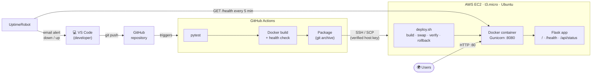
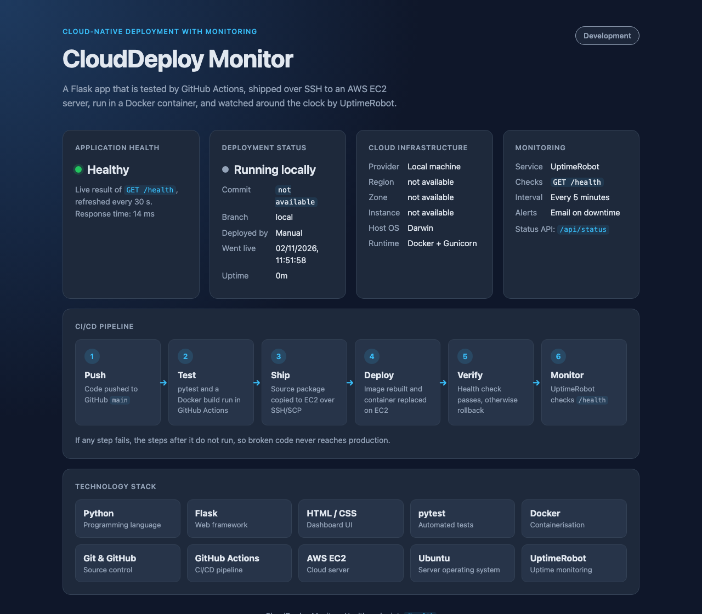

# CloudDeploy Monitor

[](https://github.com/sagniksannigrahi/clouddeploy-monitor/actions/workflows/deploy.yml)

**Automated Cloud-Native Application Deployment with Monitoring**

A small Flask web app that is automatically tested by GitHub Actions, shipped over SSH to an **AWS EC2** server, run in a **Docker** container, and monitored for downtime by **UptimeRobot**.

> In this README, replace `<EC2_PUBLIC_IP>` with your instance's current public IPv4 address.

---

## 1. Project overview

Every push to the `main` branch starts an automated pipeline:

1. **Test:** pytest runs the test suite.
2. **Build:** the Docker image is built and its `/health` endpoint is checked.
3. **Ship:** the code is packaged and copied to the EC2 server with `scp`.
4. **Deploy:** the server rebuilds the image and replaces the running container.
5. **Verify:** a health check confirms the new version works. If it doesn't, the previous version is restored automatically.
6. **Monitor:** UptimeRobot checks `http://<EC2_PUBLIC_IP>/health` every 5 minutes and emails you if it goes down.

## 2. Problem statement

Deploying by hand (copying files, restarting servers) is slow and error-prone. It is easy to skip tests, ship broken code, or find out the site is down only when someone complains. This project shows how to remove those manual steps using free tools and a single small cloud server.

## 3. Objectives

1. Run automated tests on every push to GitHub.
2. Package the application as a Docker image.
3. Deploy automatically to an AWS EC2 instance after tests pass.
4. Serve the application on a public IP address (HTTP, port 80).
5. Monitor availability through a health-check endpoint.
6. Detect downtime and send email notifications.

## 4. Technology stack

| Technology | Role | Cost |
|---|---|---|
| Python 3.14 + Flask | Web application (`/`, `/health`, `/api/status`) | Free |
| Gunicorn | Production web server inside the container | Free |
| HTML / CSS | Dashboard UI (plus a few lines of plain JavaScript for the live health check) | Free |
| pytest | Automated tests (15 tests) | Free |
| Docker | Containerisation on the server and in CI | Free (Docker Engine) |
| Git & GitHub | Version control and code hosting | Free |
| GitHub Actions | CI/CD pipeline | Free for public repositories |
| AWS EC2 (t3.micro, Ubuntu 26.04 LTS) | Cloud server | Uses AWS Academy credits while running |
| UptimeRobot | Uptime monitoring and email alerts | Free plan (50 monitors, 5-minute checks) |

## 5. Architecture



Port mapping: the internet reaches **port 80** on EC2. Docker forwards it to Gunicorn on **port 8080** inside the container. Port 8080 is never opened in the security group.

## 6. Project structure

```
cloud-deployment/
├── app.py                    # Flask app: "/" dashboard, "/health", "/api/status"
├── templates/index.html      # Dashboard page
├── static/style.css          # Dashboard styling
├── test_app.py               # pytest suite (15 tests)
├── requirements.txt          # Runtime dependencies (Flask, Gunicorn)
├── requirements-dev.txt      # + pytest, for local development and CI
├── Dockerfile                # Container image definition
├── .dockerignore             # Files kept out of the image
├── deploy.sh                 # Runs on EC2: build, swap container, health check, rollback
├── .github/workflows/
│   └── deploy.yml            # GitHub Actions CI/CD pipeline
├── docs/screenshots/         # Screenshots for this README
├── .gitignore                # Keeps .venv, keys, credentials and caches out of Git
└── README.md
```

## 7. Local installation

Requirements: Python 3.12+, Git, and Docker Desktop (optional, for container testing).

```bash
git clone https://github.com/sagniksannigrahi/clouddeploy-monitor.git
cd clouddeploy-monitor
python3 -m venv .venv
source .venv/bin/activate          # Windows: .venv\Scripts\activate
pip install -r requirements-dev.txt
```

## 8. Local execution

```bash
source .venv/bin/activate
python app.py
```

| URL | What it shows |
|---|---|
| <http://localhost:8080/> | Dashboard |
| <http://localhost:8080/health> | `{"application":"CloudDeploy Monitor","status":"healthy"}` |
| <http://localhost:8080/api/status> | Version, deployment and runtime details (no secrets) |

> macOS uses port 5000 for AirPlay, so this project defaults to **8080**. Use another port with `PORT=9000 python app.py`.

## 9. Docker

```bash
docker build -t clouddeploy-monitor .
docker run --rm -p 8080:8080 clouddeploy-monitor     # open http://localhost:8080
```

How the Dockerfile is set up:

- `python:3.14-slim` base image (small, official).
- Dependencies are installed before the code is copied, so rebuilds reuse the cached layer.
- Runs as a non-root user (`appuser`).
- Gunicorn binds `0.0.0.0:${PORT}` (default 8080) with 2 workers, which is light enough for a t3.micro.
- A `HEALTHCHECK` lets `docker ps` show `(healthy)`.
- Build arguments (`GIT_COMMIT`, `GIT_BRANCH`, `BUILD_TIME`) are baked into the image so the dashboard shows which version is running.

On the server, `deploy.sh` starts the container with:

| Option | Why |
|---|---|
| `--restart unless-stopped` | Restarts after crashes and after the EC2 server reboots |
| `-p 80:8080` | Public HTTP port 80 → app port 8080 |
| `--memory 300m` | Prevents the app from using up the t3.micro's 1 GB RAM |
| `--log-opt max-size=10m --log-opt max-file=3` | Logs are rotated so they can't fill the disk |

## 10. AWS EC2 setup

### Instance

| Setting | Value |
|---|---|
| AMI | Ubuntu Server 26.04 LTS |
| Instance type | t3.micro (2 vCPU, 1 GB RAM) |
| Region | us-east-1 |
| Storage | Default 8 GB gp3 is enough |
| Key pair | Your own key pair (keep the `.pem` file safe) |

### Security group (inbound rules)

| Type | Port | Source | Purpose |
|---|---|---|---|
| SSH | 22 | See note below | Admin access and GitHub Actions deploys |
| HTTP | 80 | `0.0.0.0/0` | Public website and UptimeRobot |

Nothing else is opened. In particular, Flask/Gunicorn's port 8080 is **not** public.

> **SSH source and GitHub Actions:** GitHub-hosted runners connect from changing IP addresses. If port 22 allows only your IP, the automatic deploy step can't connect. In that case, either allow `0.0.0.0/0` on port 22 (login is key-only and password login is disabled) or deploy manually from your Mac (section 14).

### One-time server preparation

Run on the server over SSH. It installs only Docker Engine and the folder the app needs:

```bash
sudo apt-get update
sudo apt-get install -y docker.io        # Docker Engine from Ubuntu's repository
sudo systemctl enable --now docker       # start Docker now and on every boot
sudo usermod -aG docker ubuntu           # let the ubuntu user run docker (log out/in after)
sudo mkdir -p /opt/clouddeploy
sudo chown ubuntu:ubuntu /opt/clouddeploy
```

### Cost tips for AWS Academy

- Use only this one t3.micro instance. No Elastic IP, load balancer or NAT gateway is needed.
- **Stopping** the instance saves credits, but its **public IP changes** when it starts again. After a restart, update the `EC2_HOST` and `EC2_KNOWN_HOSTS` secrets and the UptimeRobot URL.
- `deploy.sh` deletes old Docker images after each deploy, keeping only the current and previous ones to save disk space.

## 11. SSH connectivity

```bash
chmod 400 ~/Downloads/<your-key>.pem                 # SSH refuses keys others can read
ssh -i ~/Downloads/<your-key>.pem ubuntu@<EC2_PUBLIC_IP>
```

The first time you connect, SSH shows the server's host key fingerprint. To confirm it is really your server, compare it with the fingerprint in **EC2 → Instance → Actions → Monitor and troubleshoot → Get system log** (look for `BEGIN SSH HOST KEY FINGERPRINTS`).

If it fails:

| Symptom | Likely cause |
|---|---|
| `Operation timed out` | Security group doesn't allow port 22 from your IP, or the IP has changed |
| `Permission denied (publickey)` | Wrong key file or username (must be `ubuntu`) |
| `UNPROTECTED PRIVATE KEY FILE` | Run `chmod 400` on the key |

## 12. GitHub repository setup

```bash
git init -b main
git add .
git commit -m "Initial commit"
gh repo create clouddeploy-monitor --public --source . --push
```

`.gitignore` makes sure `.venv/`, `.env`, `*.pem` and other keys, AWS credentials, `known_hosts` and cache files are never committed.

## 13. GitHub Actions CI/CD

Workflow file: [`.github/workflows/deploy.yml`](.github/workflows/deploy.yml)

```
push to main ─► test ─► docker ─► deploy
                pytest  build +   scp package → ssh: deploy.sh
                        /health   → verify public URL shows the new commit
```

| Trigger | test | docker | deploy |
|---|---|---|---|
| Push to `main` | ✅ | ✅ | ✅ |
| Pull request | ✅ | ✅ | ❌ never deploys |
| Manual "Run workflow" on `main` | ✅ | ✅ | ✅ |

### Required repository secrets

GitHub → repo → **Settings → Secrets and variables → Actions → New repository secret**

| Secret | Value |
|---|---|
| `EC2_HOST` | The instance's current public IPv4, e.g. `54.x.x.x` |
| `EC2_USER` | `ubuntu` |
| `EC2_SSH_KEY` | The full contents of a **private** key allowed to log in (see below) |
| `EC2_KNOWN_HOSTS` | The server's verified host key line (see below) |

**Use a dedicated deploy key, not your personal `.pem`.** You can then revoke GitHub's access without touching your own key:

```bash
# On your Mac: create a key used only by GitHub Actions
ssh-keygen -t ed25519 -N "" -C "github-actions-deploy" -f ~/.ssh/clouddeploy_deploy_key

# Allow it to log in to the server
ssh -i ~/Downloads/<your-key>.pem ubuntu@<EC2_PUBLIC_IP> \
  "cat >> ~/.ssh/authorized_keys" < ~/.ssh/clouddeploy_deploy_key.pub

# Store the secrets (values are read from files, never printed)
gh secret set EC2_HOST --body "<EC2_PUBLIC_IP>"
gh secret set EC2_USER --body "ubuntu"
gh secret set EC2_SSH_KEY < ~/.ssh/clouddeploy_deploy_key
ssh-keyscan -t ed25519 <EC2_PUBLIC_IP> > /tmp/ec2_known_hosts
ssh-keygen -lf /tmp/ec2_known_hosts      # compare with the EC2 system log fingerprint!
gh secret set EC2_KNOWN_HOSTS < /tmp/ec2_known_hosts
```

How the workflow keeps the connection secure:

- `StrictHostKeyChecking yes` with only the stored host key, so SSH refuses to connect to an impostor server.
- The private key exists on the runner only during the job and is deleted at the end (`if: always()`).
- GitHub masks secret values in logs.
- No third-party deploy actions; only `ssh` and `scp`.

If a secret is missing, the deploy job fails with a clear message listing which ones. It never reports success without deploying.

## 14. Deployment procedure

**Automatic:** push to `main`. The deploy job:

1. Packs the committed files with `git archive` (never local junk or keys).
2. Copies the package to `/tmp` on EC2 with `scp`.
3. Over `ssh`, unpacks it into `/opt/clouddeploy/app` and runs `deploy.sh <commit> main "GitHub Actions"`.
4. `deploy.sh` builds the new image while the old container keeps running, swaps the containers, and polls `/health` for up to 40 seconds.
   - **Healthy:** the old image is kept as a rollback target, and older ones are deleted.
   - **Unhealthy:** the new container is removed, the previous version is started again, and the job fails.
5. The runner fetches `http://<EC2_PUBLIC_IP>/api/status` and checks that it reports the new commit.

**Manual** (from your Mac, e.g. if SSH is limited to your IP):

```bash
git archive --format=tar.gz -o /tmp/app.tar.gz HEAD
scp -i ~/Downloads/<your-key>.pem /tmp/app.tar.gz ubuntu@<EC2_PUBLIC_IP>:/tmp/
ssh -i ~/Downloads/<your-key>.pem ubuntu@<EC2_PUBLIC_IP> \
  "rm -rf /opt/clouddeploy/app && mkdir -p /opt/clouddeploy/app && tar -xzf /tmp/app.tar.gz -C /opt/clouddeploy/app && cd /opt/clouddeploy/app && bash deploy.sh $(git rev-parse HEAD) main Manual"
```

**Useful commands on the server:**

```bash
docker ps                                   # is it running and healthy?
docker logs -f clouddeploy-monitor          # live application logs
docker stats --no-stream                    # memory/CPU usage
curl http://localhost/health                # local health check
df -h / && free -h                          # disk and RAM
```

## 15. UptimeRobot monitoring

The UptimeRobot free plan includes 50 monitors, 5-minute intervals, and email alerts. These steps require your own account.

1. Sign up at <https://uptimerobot.com> and verify your email.
2. **+ New monitor** → type **HTTP(s)**.
3. **URL:** `http://<EC2_PUBLIC_IP>/health`. **Name:** `CloudDeploy Monitor`. **Interval:** 5 minutes.
4. Under notifications, tick your **email**. You get an email when it goes down and another when it is back up.
5. Save. The monitor turns green after the first check.
6. Open the monitor to see **uptime %**, **response times** and the **incident history**.
7. *(Optional)* Create a public **Status page**. If you put its URL in the `STATUS_PAGE_URL` environment variable, the dashboard links to it.

> For a stricter check, use a **Keyword** monitor on the same URL with keyword `healthy`.

### Test the alert (for your demo)

```bash
ssh -i ~/Downloads/<your-key>.pem ubuntu@<EC2_PUBLIC_IP> "docker stop clouddeploy-monitor"
# wait 5-10 minutes → UptimeRobot marks it DOWN and emails you
ssh -i ~/Downloads/<your-key>.pem ubuntu@<EC2_PUBLIC_IP> "docker start clouddeploy-monitor"
# next check → UP email; the incident appears in the history
```

`docker stop` is used because `--restart unless-stopped` would otherwise bring a crashed container straight back.

> If the EC2 public IP changes (after stop/start), edit the monitor's URL.

## 16. Testing

```bash
pytest -v
```

| Area | Tests |
|---|---|
| Homepage | 200 status, HTML content type, all dashboard sections present, stylesheet served |
| `/health` | 200 status, JSON content type, exact expected body |
| `/api/status` | 200 JSON, required fields present, reports EC2 details when deployed, never leaks secrets, IPs or instance IDs |
| Behaviour | 404 for unknown pages, 405 for `POST /health`, local vs. EC2 display |

`deploy.sh` was also tested end-to-end with Docker: a good release goes live, and a deliberately broken release fails its health check and is automatically rolled back.

## 17. Screenshots

| Screen | Image |
|---|---|
| Dashboard (local) |  |
| Dashboard on EC2 | *add `docs/screenshots/dashboard-ec2.png`* |
| GitHub Actions run | *add `docs/screenshots/github-actions.png`* |
| `docker ps` on EC2 | *add `docs/screenshots/docker-ps.png`* |
| UptimeRobot monitor | *add `docs/screenshots/uptimerobot.png`* |

## 18. Future enhancements

- HTTPS with a domain name and a free Let's Encrypt certificate (via a reverse proxy such as Caddy).
- Build the image once in CI, push it to a registry (GitHub Container Registry), and pull it on EC2, so the server doesn't spend CPU building.
- Zero-downtime deploys (start the new container on a second port, then switch traffic).
- Slack or Discord alerts in addition to email.
- Linting (`ruff`) and test coverage reports in the pipeline.
- Infrastructure as code for the EC2 setup, once the project needs more than one server.
